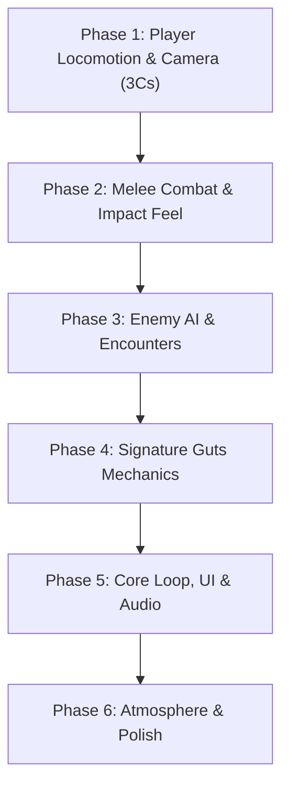

# ⚔️ Berserk: Game Development Roadmap

A third-person, dark fantasy hack-and-slash action game inspired by Kentaro Miura's *Berserk*. Built in Unity (URP) with a focus on brutal, weighty melee combat, visceral dismemberment, and tactical encounters.

---

## 🛠️ Project Overview & Architecture

* **Engine:** Unity 6 (`6000.3.9f1`)
* **Render Pipeline:** Universal Render Pipeline (URP)
* **Version Control:** Git + Git LFS (Large File Storage)
* **Core Pillars:**
  1. **Weight & Impact:** Every swing of the Dragonslayer must feel massive, dangerous, and physically convincing.
  2. **Brutality & Fluidity:** Seamless transitions between heavy greatsword strikes, arm-cannon blasts, and reactive dodges.
  3. **Grim Atmosphere:** High-contrast lighting, volumetric fog, particle VFX, and responsive blood/gore decal systems.

---

## 🗺️ Phased Roadmap

---

### Phase 1: Player Locomotion, Controls & Camera (The "3 Cs") (:white_check_mark: CORE COMPLETE)
> **Goal:** Ensure moving and controlling Guts feels responsive, fluid, and grounded before layering combat mechanics.

- [x] **1.1 Locomotion Polish**
  - Smooth movement blending (Walk ➔ Sprint), downward grounded physics clamping.
  - Footstep audio synchronization linked to locomotion states.
- [x] **1.2 Dodge / Roll Mechanic**
  - Directional combat roll (`Combat_Roll`) with invulnerability frames (i-frames).
  - Cancel windows from light movement or idle states into rolls.
- [ ] **1.3 Camera & Targeting Polish**
  - Third-person orbit camera with collision detection.
  - Optional lock-on targeting system with target-switching.

---

### Phase 2: Melee Combat & Animation Feel (:white_check_mark: CORE COMPLETE)
> **Goal:** Capture the overwhelming weight and lethality of the Dragonslayer sword.

- [x] **2.1 Attack Buffering & Combo System**
  - Input buffering for fluid light and heavy combo chains (`attack1`, `attack2`, `attack3`).
  - Dragonslayer block stance (`85%` damage absorption) and cancel windows into dodge.
- [x] **2.2 Hit Detection & Layer Masking**
  - Discrete blade trigger hitboxes along Dragonslayer mesh with active swing frame windows.
  - Upper-body animation masking allowing locomotion while equipping/swinging.
- [x] **2.3 Hit Feedback (Game Feel / Juiciness)**
  - **Hitstop / Frame Freeze:** 0.07s micro-pause on both attacker and victim upon connection.
  - **Camera Shake:** Directional, proportional camera impulse on heavy impacts.
  - Directional weapon trail (crimson surge during Beast of Darkness).

---

### Phase 3: Enemy AI & Visceral Combat Encounters
> **Goal:** Transform enemies into tactical, lethal opponents with defensive stances, dynamic multi-attack combos, and bone-jarring blade clashes.

- [x] **3.1 Modular AI Architecture & Perception** (:white_check_mark: COMPLETED)
  - Decoupled into `EnemyPerception.cs` (110° vision cone, stealth sprint hearing, close-quarters memory latch, investigation tracking).
  - Decoupled into `EnemyCombat.cs` (hit reaction stagger, fake-death revival, Beast feast +20 HP, ragdoll launch).
  - High-quality NavMesh obstacle avoidance with randomized priority (30–70) and horde screech alert propagation (16m).
- [x] **3.2 Blade-on-Blade Clashing & Metal Sparks (Conflict Feedback)** (:white_check_mark: COMPLETED)
  - Real-time blade vs blade & blade vs guard collision detection.
  - High-velocity directional friction sparks VFX (`flashEffectPrefab`) at sword contact point.
  - Resonant heavy steel *CLANG* audio design (`sword_clash.wav`).
  - Dual hitstop micro-freeze (0.07s - 0.09s) on both Guts and enemy for massive kinetic resistance.
  - Camera shudder impulse and deflection feedback.
- [x] **3.3 Enemy Self-Defense & Defensive Stances** (:white_check_mark: CORE COMPLETE)
  - Replaced hurt flinch with dedicated defensive block deflection (`OneHand_Up_Shield_Block_Hit_1_InPlace`).
  - Guard mitigation: 85% damage absorption on blocked hits (`damageReductionPercent = 0.85f`).
  - Real-time weapon deflection sound & sparks.
  - Tactical evasion: defensive backstep hop (`Combat_Dodge_Back`) to escape heavy combo finishers.
- [x] **3.4 Multi-Attack Arsenal & Combo Chaining** (:white_check_mark: COMPLETED)
  - **Attack 0 (Light Slash):** Fast horizontal sweep (`attack0.anim`), 0.30s impact window.
  - **Attack 1 (Heavy Overhead Cleave):** Downward power chop (`OneHand_Up_Attack_2_InPlace.anim`), 1.4x damage, 0.55s windup.
  - **Attack 2 (Lunging Gap-Closer):** Forward lunge thrust (`OneHand_Up_Attack_3_InPlace.anim`) from 2.5m - 3.2m distance.
  - Distance-based tactical attack selection & independent damage timing routines.
- [x] **3.5 Tactical Combat Brain (Spacing, Circling & Counters)** (:white_check_mark: COMPLETED)
  - Orbital combat strafing / circling at 2.5m - 3.5m spacing instead of mindless charging.
  - Distinct visual wind-up tells and audible grunts before heavy strikes.
  - Punish window AI: immediate counter-attack if Guts whiffs or strikes an active enemy guard.
  - Round-robin token manager with anti-starvation queue and Scene view debug Gizmos.

---

### Phase 4: Signature Guts Mechanics (:white_check_mark: COMPLETED)
> **Goal:** Deliver the authentic Berserk character fantasy.

- [x] **4.1 Prosthetic Left Arm Cannon**
  - Aim mode (`Right Mouse`) & quick-fire for cannonball projectile.
  - Devastating explosive area-of-effect damage, debris smoke VFX, and ragdoll radial physics launch.
  - Recoil animation, firing cooldown, and authentic audio synthesis.
- [x] **4.2 Visceral Blood & Gore System**
  - Directional blood splatter particles matching Dragonslayer swing vectors.
  - Surface decal projection on terrain, obstacles, and enemy meshes.
- [x] **4.3 Dynamic Dismemberment System**
  - Decapitation and limb severing on lethal strikes with severed neck arterial blood fountain.
  - Multi-zone physics bone collapse, static severed mesh baking, and bone ragdoll separation.
- [x] **4.4 Beast of Darkness Awakening (The 4 Pillars)**
  - Dynamic rage accumulation meter (+12 per damage taken, +8 per sword strike).
  - Procedural blood vignette, heartbeat pulse, predatory FOV zoom, and crimson sword trail.
  - Demonic red eye ribbon trail with point light on Guts' head socket.
  - Visceral vampirism (+5 HP lifesteal per hit, +20 HP burst on kill) and 2.8x ragdoll launch force.

---

### Phase 5: Core Game Loop, HUD & Sound
> **Goal:** Wrap systems into a cohesive, playable game experience.

- [ ] **5.1 HUD & Interface**
  - Health bar, Stamina bar, and Berserk / Rage meter.
  - Cannon ammunition / cooldown display.
  - Lock-on crosshair indicator.
- [ ] **5.2 Progression & Damage Loop**
  - Player health, damage calculation, defense stats, and death flow.
  - Checkpoint and respawn management.
- [ ] **5.3 Audio Architecture**
  - Adaptive soundtrack switching between exploration ambient and intense combat themes.
  - Layered sword swings (light swoosh vs deep sonic whoosh for heavy swings).
  - Visceral flesh cleave and bone crush audio design.

---

### Phase 6: Atmosphere, Environment & Optimization
> **Goal:** Establish a haunting dark fantasy visual identity and rock-solid performance.

- [ ] **6.1 URP Lighting & Post-Processing**
  - Custom color grading (dark, gritty, high contrast).
  - Volumetric fog, bloom, and ambient occlusion.
  - Dynamic weather / atmospheric wind affecting Guts' cape cloth simulation.
- [ ] **6.2 Performance & Optimization**
  - Mesh and animation LODs.
  - Particle system budget and draw call optimization.
  - Target: Solid 60+ FPS at 1080p/1440p.

---

## 📋 Git Workflow & Conventions

* **Commit Format:** `[Phase-X] Description of feature or fix` (e.g. `[Phase-1] Implement smooth rotation damping for player locomotion`)
* **Large Files:** All 3D meshes (`.fbx`, `.obj`), textures (`.png`, `.tga`, `.psd`), audio (`.wav`, `.mp3`), and video assets are tracked through **Git LFS**.
