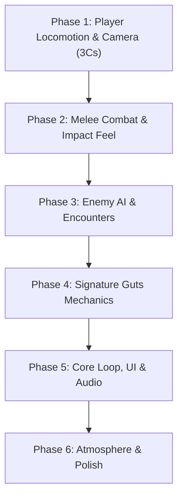

# ⚔️ Berserk: Game Development Roadmap

A third-person, dark fantasy hack-and-slash action game inspired by Kentaro Miura's *Berserk*. Built in Unity (URP) with a focus on brutal, weighty melee combat, visceral dismemberment, and tactical encounters.

---

## 🛠️ Project Overview & Architecture

* **Engine:** Unity 6 (`6000.3.9f1`)
* **Render Pipeline:** Universal Render Pipeline (URP)
* **Version Control:** Git + Git LFS (Large File Storage)
* **Core Pillars:**
  1. **Weight & Impact:** Every swing of the Dragonslayer must feel massive, dangerous, and physically convincing.
  2. **Brutality & Fluidity:** Seamless transitions between heavy greatsword strikes, arm-cannon blasts, and reactive dodges.
  3. **Grim Atmosphere:** High-contrast lighting, volumetric fog, particle VFX, and responsive blood/gore decal systems.

---

## 🗺️ Phased Roadmap

---

### Phase 1: Player Locomotion, Controls & Camera (The "3 Cs")
> **Goal:** Ensure moving and controlling Guts feels responsive, fluid, and grounded before layering combat mechanics.

- [ ] **1.1 Locomotion Polish**
  - Smooth 8-directional movement blending (Walk ➔ Jog ➔ Sprint).
  - Damped rotation interpolation (`Mathf.SmoothDampAngle`) to prevent abrupt model snapping.
  - Footstep audio synchronization linked to animation contact events.
- [ ] **1.2 Dodge / Roll Mechanic**
  - Directional combat roll/dash with invulnerability frames (i-frames).
  - Stamina consumption and recovery delays.
  - Cancel windows from light movement or idle states.
- [ ] **1.3 Camera & Targeting System**
  - Third-person orbit camera with collision detection (prevent clipping through terrain/walls).
  - Smooth camera distance adjustment during sprints and combat encounters.
  - Lock-on targeting system with target-switching via mouse flick.

---

### Phase 2: Melee Combat & Animation Feel
> **Goal:** Capture the overwhelming weight and lethality of the Dragonslayer sword.

- [ ] **2.1 Attack Buffering & Combo System**
  - Queue input buffering (0.2s - 0.3s window) for fluid light and heavy combo chains.
  - Branching attack strings (Light Combo, Heavy Finisher, Running Slash).
  - Attack recovery cancel windows into dodge or block.
- [ ] **2.2 Precision Hit Detection**
  - Weapon-arc raycasting / discrete blade hitboxes along the sword mesh to prevent phantom hits.
  - Hitbox activation tied tightly to active swing frames.
- [ ] **2.3 Hit Feedback (Game Feel / Juiciness)**
  - **Hitstop / Frame Freeze:** Brief (0.05s - 0.1s) animation pause upon connecting with enemies.
  - **Camera Shake:** Directional, proportional camera impulse on heavy impacts.
  - **Sparks & Metal Clangs:** Dynamic VFX/SFX on armor or parry collisions.

---

### Phase 3: Enemy AI & Combat Encounters
> **Goal:** Transform enemies into readable, challenging, and tactical opponents.

- [ ] **3.1 AI State Machine Architecture**
  - States: `Idle`, `Patrol`, `Alert/Investigate`, `Approach`, `Telegraph/Windup`, `Attack`, `Stagger`, `Death`.
  - NavMesh pathfinding with dynamic obstacle avoidance.
- [ ] **3.2 Readable Attack Telegraphing**
  - Clear visual and audio wind-ups prior to enemy damage frames.
  - Unblockable attack visual indicators.
- [ ] **3.3 Reaction & Stagger Dynamics**
  - Directional flinch and stagger animations based on hit force.
  - Knockdown and recovery states from heavy Dragonslayer strikes.
- [ ] **3.4 Combat Slot Manager (Group Coordination)**
  - Token/slot manager ensuring mobs coordinate attacks rather than striking simultaneously.

---

### Phase 4: Signature Guts Mechanics
> **Goal:** Deliver the authentic Berserk character fantasy.

- [ ] **4.1 Prosthetic Left Arm Cannon**
  - Quick-draw and aim modes for the arm cannon.
  - Devastating explosive projectile with area-of-effect (AOE) damage and ragdoll physics.
  - Heavy recoil animation, smoke VFX, and ammo / cooldown balance.
- [ ] **4.2 Visceral Blood & Gore System**
  - Directional blood splatter particles matching sword swing vectors.
  - Surface decal projection on terrain, obstacles, and enemy meshes.
- [ ] **4.3 Dynamic Dismemberment System**
  - Slice/sever mechanics on lethal strikes (limbs, torso cleave).
  - Ragdoll separation with blood spray emitters on severed joints.

---

### Phase 5: Core Game Loop, HUD & Sound
> **Goal:** Wrap systems into a cohesive, playable game experience.

- [ ] **5.1 HUD & Interface**
  - Health bar, Stamina bar, and Berserk / Rage meter.
  - Cannon ammunition / cooldown display.
  - Lock-on crosshair indicator.
- [ ] **5.2 Progression & Damage Loop**
  - Player health, damage calculation, defense stats, and death flow.
  - Checkpoint and respawn management.
- [ ] **5.3 Audio Architecture**
  - Adaptive soundtrack switching between exploration ambient and intense combat themes.
  - Layered sword swings (light swoosh vs deep sonic whoosh for heavy swings).
  - Visceral flesh cleave and bone crush audio design.

---

### Phase 6: Atmosphere, Environment & Optimization
> **Goal:** Establish a haunting dark fantasy visual identity and rock-solid performance.

- [ ] **6.1 URP Lighting & Post-Processing**
  - Custom color grading (dark, gritty, high contrast).
  - Volumetric fog, bloom, and ambient occlusion.
  - Dynamic weather / atmospheric wind affecting Guts' cape cloth simulation.
- [ ] **6.2 Performance & Optimization**
  - Mesh and animation LODs.
  - Particle system budget and draw call optimization.
  - Target: Solid 60+ FPS at 1080p/1440p.

---

## 📋 Git Workflow & Conventions

* **Commit Format:** `[Phase-X] Description of feature or fix` (e.g. `[Phase-1] Implement smooth rotation damping for player locomotion`)
* **Large Files:** All 3D meshes (`.fbx`, `.obj`), textures (`.png`, `.tga`, `.psd`), audio (`.wav`, `.mp3`), and video assets are tracked through **Git LFS**.
